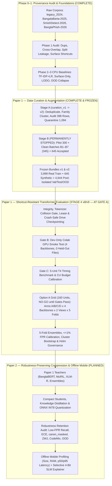

# Bangla & Code-Mixed SMS Smishing Detection — Complete Research & Engineering Handbook

> **A complete guide to our research program, scientific objectives, dataset provenance, anti-leakage & shortcut-resistance methodology, statistical governance, and offline mobile deployment roadmap.**

This repository houses an end-to-end, provenance-aware research and engineering pipeline modernized from a legacy 2024 mobile SMS spam prototype ([`documents.md`](documents.md), [`DataSet.csv`](DataSet.csv)) into a two-paper research program targeting robust, low-false-positive, and privacy-preserving Bangla & Code-Mixed SMS smishing detection.

---

## Table of Contents

1. [Target Papers & Research Vision](#1-target-papers--research-vision)
2. [End-to-End Research Architecture](#2-end-to-end-research-architecture)
3. [Task Formulation, Taxonomy & Evaluation Protocol](#3-task-formulation-taxonomy--evaluation-protocol)
4. [Data Provenance, Audit & Two-Stage Curation (Stages A & B)](#4-data-provenance-audit--two-stage-curation-stages-a--b)
5. [Paper 1 Experimental Matrix & Modeling Protocol](#5-paper-1-experimental-matrix--modeling-protocol)
6. [Paper 2 Compression, Robustness & Offline Mobile Deployment Plan](#6-paper-2-compression-robustness--offline-mobile-deployment-plan)
7. [Statistical Inference, Integrity & Fail-Closed Governance](#7-statistical-inference-integrity--fail-closed-governance)
8. [Current Status & Gate Tracker](#8-current-status--gate-tracker)
9. [Repository Map](#9-repository-map)
10. [Quickstart & Local Verification](#10-quickstart--local-verification)
11. [Working Rules, Provenance & Licensing Boundaries](#11-working-rules-provenance--licensing-boundaries)

---

## 1. Target Papers & Research Vision

Bangladeshi mobile users receive high volumes of SMS across **Bengali Unicode**, **Banglish (Romanized Bengali)**, **English**, and **Code-Mixed** text—ranging from ordinary personal/transactional messages (OTPs, bank alerts, BTRC/civic notices) and legitimate commercial promotions to high-stakes **smishing** attacks targeting mobile financial services (bKash, Nagad, Rocket), bank accounts, and credentials.

Our legacy 2024 prototype (*বাংলা বার্তা সুরক্ষা*, documented in [`documents.md`](documents.md)) relied on binary spam/ham classification (`DataSet.csv`) and a cloud-hosted MobileBERT FastAPI endpoint on Hugging Face Spaces. Auditing modern 2025–2026 benchmarks exposed two deep scientific and deployment gaps that define our two target papers:

### Paper 1 — Data Integrity, Shortcut Resistance & Synthetic Augmentation
> **Title:** *Provenance-Aware and Shortcut-Resistant Evaluation of Synthetic Augmentation for Bangla and Code-Mixed SMS Smishing Detection under Low-FPR Constraints*

* **Core Problem:** Public Bangla SMS benchmarks exhibit severe exact duplication (up to `56.53%` in `BangalaBarta`), hidden cross-dataset overlap (`100%` of `BangalaBarta`'s `1,205` unique texts are contained inside `SmishDetect-2026`), predefined train/eval leakage, mislabeled scripts/classes, and strong superficial shortcuts (URLs, phone numbers, USSD codes, character length, brand names). Meanwhile, naive LLM synthetic balancing introduces synthetic-origin artifacts (punctuation habits, template hooks, brand concentration, placeholder patterns) that inflate apparent CV scores without improving true semantic generalization.
* **Research Hypotheses & Objectives:**
  1. **Provenance-Aware Deduplication & Isolation:** Unify multi-source SMS corpora with full row-level lineage (`provenance.parquet`), `cos >= 0.85` family clustering, mandatory ambiguity quarantining, and strict held-out/OOD isolation (`smishdetect_validation`, `smishdetect_test`, `BanglaPhish-2026`).
  2. **Shortcut-Resistant Evaluation:** Quantify reliance on superficial cues using multi-view masking (`raw` vs. `canon_masked` [`<URL>/<PHONE>/<USSD>`]), adversarial zero-width-joiner (ZWJ) and homoglyph perturbations, counterfactual entity/brand swaps, and zero-shot OOD evaluation (`BanglaPhish-2026`).
  3. **Controlled, Audited Synthetic Augmentation:** Fill measured training-only class and language deficits (specifically under-represented `Promotional` SMS) via iterative, independently reviewed batches while transparently measuring both surface-level alignment and residual lexical synthetic-origin separability.
  4. **Low-FPR Operational Rigor:** Evaluate whether class-weighted real data or audited synthetic augmentation improves **both** 3-class Macro-F1 and **Smishing Recall @ `<= 1%` Normal-as-Smishing FPR** across four pinned transformer backbones (`BanglaBERT`, `MuRIL`, `XLM-RoBERTa`, `Distil-mBERT`) using frozen validation-calibrated 5-fold ensembles and family-clustered statistical inference.

### Paper 2 — Robustness-Preserving Model Compression & Offline Mobile Deployment
> **Title:** *Robustness-Preserving Compression of Multilingual Smishing Detection Models for Offline Mobile Deployment*

* **Core Problem:** Full-sized multilingual/Bangla transformers (`BanglaBERT`, `MuRIL`, `XLM-RoBERTa`) are too heavy for low-latency, offline mobile SMS filtering, while transmitting personal SMS texts to remote cloud APIs violates user privacy and fails offline. Conversely, standard compression benchmarks typically track only clean Macro-F1 against model size—hiding silent regressions in **low-FPR Smishing Recall**, **probability calibration (ECE)**, **shortcut resistance (`canon_masked`)**, **adversarial ZWJ/homoglyph robustness**, **Code-Mixed/Banglish equity**, and **OOD transfer (`BanglaPhish-2026`)**.
* **Research Hypotheses & Objectives:**
  1. **From Paper 1 Teachers to Compact Students:** Use Paper 1's leakage-free corpus, frozen splits, and best-performing full-precision teachers to benchmark compact architectures (`distilbert-base-multilingual-cased`, `google/mobilebert-uncased`, and knowledge-distilled students) under identical low-FPR and shortcut-stress protocols.
  2. **Robustness-Preserving Quantization & Compression:** Export and compress models via ONNX Runtime (`FP32` → `INT8` dynamic/static quantization, distillation/pruning ablations) and measure **robustness retention** across every Paper 1 stress axis (`canon_masked`, ZWJ/homoglyph, counterfactual swaps, per-language slices, and `BanglaPhish-2026` OOD) rather than clean accuracy alone.
  3. **Offline On-Device Deployment Profile:** Benchmark true offline CPU/mobile inference efficiency (disk size in MB, peak RAM delta, `p50`/`p95` single-SMS latency on CPU/XNNPACK baselines, accounting for Android 15 NNAPI deprecation vs. ORT CPU/XNNPACK execution providers) with zero cloud transmission of SMS content.
  4. **Selective On-Device Cue-Grounded Explanations (Extension Track):** Evaluate triggering a 4-bit quantized 1B–1.5B Small Language Model (`Qwen/Qwen2.5-1.5B-Instruct` or `google/gemma-3-1b-it`) *selectively* only on flagged/borderline Smishing alerts, grounded strictly in extracted structural cues (URLs, phone numbers, impersonated brands), to generate concise Bangla safety warnings without paying LLM latency on benign SMS.

---

## 2. End-to-End Research Architecture

Paper 1 establishes the **trusted, leakage-free data foundation, shortcut-resistant evaluation protocol, and full-precision teacher models**, which feed directly into Paper 2's **robustness-preserving compression and offline mobile deployment evaluation**:



---

## 3. Task Formulation, Taxonomy & Evaluation Protocol

### 3.1 Canonical 3-Class Label Taxonomy
All primary experiments operate on three canonical classes (`CANONICAL_LABELS` in [`src/bangla_smish/schema.py`](src/bangla_smish/schema.py)):

| Label | Definition | Critical Boundary Rules ([`reports/stage_a_focused_audit_v2.md`](reports/stage_a_focused_audit_v2.md)) |
| :--- | :--- | :--- |
| **`Normal`** | Ordinary personal communication, legitimate transactional/service alerts, OTP/PIN notices, telecom balance receipts, scheduled maintenance, BTRC/civic/government PSAs, and non-commercial holiday greetings. | Urgency, links, or OTP mentions alone do **not** make a message Smishing. |
| **`Promotional`** | Legitimate commercial advertising, telecom data/voice bundles, retail discounts, identifiable college admission ads, and event/contest drives without deceptive extraction. | Distinguished from `Normal` by commercial/participation offer; distinguished from `Smishing` by absence of deceptive credential/money extraction. |
| **`Smishing`** | Deceptive messages intended to extract credentials (PIN/OTP/passwords), money, sensitive personal data, or malicious app installation (including fake family-emergency scams and prize/KYC/account-block lures). | Must exhibit deceptive extraction intent rather than merely containing a phone number or URL. |
| **`Quarantined`** *(Excluded)* | Ambiguous messages whose ground truth depends on unavailable sender identity/context (e.g., bare numbers demanding bKash/money without context, unattributed deduction alerts, unverified callbacks) or legacy binary-only labels. | Quarantined rather than guessed (`1,094` groups in `curation_v2/quarantined.parquet`). |

### 3.2 Linguistic Subgroups (`4` Languages)
Because script-only detectors conflate Romanized Bengali (`Banglish`) with `English`, `curation_v2` enforces explicit linguistic definitions across all training and evaluation cohorts:
* **`Bengali`:** Bengali matrix syntax written in Bengali Unicode script (`[\u0980-\u09FF]`), allowing isolated loanwords/URLs (`OTP`, `MB`, `bKash`).
* **`Banglish`:** Bengali matrix syntax written in Roman/Latin script (`[A-Za-z]`).
* **`English`:** English matrix syntax in Latin script (including Bangladeshi English terms like `taka`, `lakh`, `Eid`).
* **`CodeMix`:** Productive intra-/inter-sentential switching across Bengali and English/Banglish clauses.

### 3.3 Text Views, Adversarial & Counterfactual Stress Probes
To test whether models rely on genuine semantic intent rather than superficial surface tokens, every dataset bundle pre-computes four text views plus adversarial and counterfactual transformations:

| View / Stress Probe | Transformation | Role in Paper 1 & Paper 2 |
| :--- | :--- | :--- |
| **`raw`** | Original SMS text (whitespace-normalized). | **Reference view** (`0/280` Option A cross-boundary collisions). |
| **`canon_masked`** | Replaces URLs, phone numbers (ASCII & Bengali digits, excluding currency amounts), and USSD codes with canonical `<URL>`, `<PHONE>`, `<USSD>` tags. | **Primary shortcut-resistant view** (`0/280` Option A collisions; independent of Stage B fictional brand registry). |
| **`brand_masked`** / **`brand_stripped`** | Replaces or strips known real & fictional brands (`<BRAND>` / `""`) with NFC + Bengali/Banglish inflection matching. | Used in **Stage B synthetic-origin diagnostics**; **blocked in Option A confirmatory mode** after Stage 3 audit discovered `128/560` exact transformed-string collisions originating from 3 Smishing row pairs across split boundaries. |
| **Adversarial ZWJ / Homoglyph** | Injects zero-width joiners and visually similar Unicode characters (`text_adv_raw`, `text_adv_canon_masked`). | Evaluates character-obfuscation resilience for both Paper 1 backbones and Paper 2 compressed students. |
| **Counterfactual Smishing Probe** | `1,279` real Smishing rows with swapped synthetic contact tokens (`contact_swap`) and synthetic brand swaps (`contact_and_brand_swap`). | Quantifies whether synthetic Promotional contact/brand conventions leak into false benign predictions. *(Disclosed behavior: in `canon_masked`, `contact_swap` is a `98.59%` no-op [`1,261/1,279` + `18` trailing-period artifacts], while `contact_and_brand_swap` remains active on `238/1,279` [`18.61%`] brand-bearing rows.)* |

### 3.4 Operational Metrics & Low-FPR Constraint
Blocking legitimate bank OTPs or personal SMS (`Normal → Smishing` false positives) destroys user trust in mobile spam filters. Therefore, standard accuracy is insufficient:
1. **3-Class Macro-F1** (primary class-balanced discrimination metric).
2. **Smishing Recall @ `<= 1%` Normal-as-Smishing FPR** (primary security utility metric, computed with tie-safe `np.nextafter` descending order statistics in [`src/bangla_smish/metrics.py`](src/bangla_smish/metrics.py)).
   * *Frozen Threshold Transfer:* Operating thresholds are calibrated strictly on **`smishdetect_validation`** (`265` Normal rows → at most `k <= 2` Normal FPs) and transferred frozen to `smishdetect_test` and `BanglaPhish-2026` OOD.
   * *Statistical Honesty Disclosure:* On `n = 265` validation Normal rows, exact 95% one-sided Clopper–Pearson upper confidence bounds are `1.1241%` (`k=0`), `1.7775%` (`k=1`), and `2.3566%` (`k=2`). Thus, `<= 1%` validation calibration defines a frozen empirical operating point rather than a population FPR upper bound.
3. **Normal→Smishing FPR (%)**, **Per-Language Subgroup Macro-F1 & Recall** (`Bengali`, `Banglish`, `English`, `CodeMix`), and **Expected Calibration Error (ECE)** (critical for Paper 2 quantization/distillation assessment).

---

## 4. Data Provenance, Audit & Two-Stage Curation (Stages A & B)

All dataset engineering follows the strict two-stage protocol in [`data/DATASET_GUIDE.md`](data/DATASET_GUIDE.md) and [`AGENTS.md`](AGENTS.md): **never alter raw sources, consolidate existing data first, and generate synthetic samples only for measured training-only deficits**.

### 4.1 Phase 1 Audit of Source Corpora ([`reports/phase1_dataset_audit.md`](reports/phase1_dataset_audit.md))

| Source Corpus | License | Provenance | Raw Rows | Unique | Exact Dup % | Near-Dup Red. (`cos>=0.85`) | Surface-Only Macro-F1 | Length-Only AUC | Handling in Pipeline |
| :--- | :--- | :--- | ---: | ---: | ---: | ---: | ---: | ---: | :--- |
| **`legacy_2024`** (`DataSet.csv`) | `UNDOCUMENTED` | Legacy binary prototype | 2,580 | 2,083 | 19.26% | 6.00% | 88.79% | 0.8738 | **Reference-only / Quarantined** (undocumented license + binary spam labels; `54.06%` overlaps `BangalaBarta`/`SmishDetect`). |
| **`bangalabarta_2025`** | `CC BY-NC-SA 4.0` | Curated real mixed | 2,772 | 1,205 | **56.53%** | 5.23% | 67.61% | 0.8453 | **100% (`1,205/1,205`) overlaps `SmishDetect-2026`** — merged as shared provenance, never double-counted. |
| **`smishdetect_2026`** | `MIT` | Augmented multilingual | 7,005 | 6,998 | 0.10% | 7.20% | 63.85% | 0.7662 | Primary 3-class source (`train` → `eligible_train`; `val` & `test` preserved as strictly isolated held-out splits). |
| **`banglaphish_2026`** | `CC BY-NC 4.0` | Synthetic multi-channel | 6,000 | 5,416 | 9.73% | 20.81% | 64.01% | **0.9375** | **Strict Out-of-Distribution (OOD) benchmark only** (`0%` overlap with other corpora; never used in training or prompts). |

### 4.2 Stage A Consolidation & Focused Audit (`curation_v1` → `curation_v2`)
* **`curation_v1`** ([`reports/dataset_consolidation_v1.md`](reports/dataset_consolidation_v1.md)): Global normalization, exact deduplication across `18,357` provenance rows, `cos >= 0.85` near-duplicate family clustering, and strict isolation of held-out `smishdetect_validation` (`708`), `smishdetect_test` (`1,698`), and `banglaphish_ood` (`5,416`).
* **`curation_v2`** ([`reports/stage_a_focused_audit_v2.md`](reports/stage_a_focused_audit_v2.md)): Focused audit on `curation_v1/eligible_train` (`4,125` rows) logging **`398` audit decisions** (`82` label reclassifications, `178` language reclassifications correcting `Banglish`/`English`/`CodeMix` errors, `126` newly quarantined ambiguous groups, `14` boundary exemplars). Held-out validation, test, and OOD partitions remained **100% untouched**.
* **Resulting Stage A Inventory (`data/processed/curation_v2/`):**
  * `existing_unique.parquet`: **`11,821`** unique accepted rows (`provenance.parquet`: `18,357` raw rows; `quarantined.parquet`: `1,094` groups).
  * `eligible_train.parquet`: **`3,999`** real training rows (`3,803` families) → `Normal = 1,509`, `Promotional = 942`, `Smishing = 1,548`.
  * **Measured Stage B Deficits (`T = max(n_c) = 1,548`):** `Normal = +39`, `Promotional = +606`, `Smishing = 0` (**Total = `645`**).

### 4.3 Stage B Controlled Synthetic Augmentation (**COMPLETE & PERMANENTLY STOPPED**)
Across eight audited campaigns ([`reports/stage_b_completion_report.md`](reports/stage_b_completion_report.md)), **`718`** candidates underwent automated deduplication/diversity screening (`0` exact or `cos >= 0.85` overlaps against all protected/held-out corpora) plus independent row-by-row review, yielding **`645` accepted rows (`89.83%`)** and `73` rejected rows preserved with reasons:

| Cohort | Class Split (`N / P / S`) | Screened → Accepted | Promo Length `P25 / P50 / P75` | Brandless % | Max Brand Freq | Diversity Gates (`8/8`) | Key Engineering Takeaway |
| :--- | :---: | :---: | :---: | ---: | ---: | :---: | :--- |
| **`eligible_train` (Real)** | `1,509 / 942 / 1,548` | — | `66.0 / 74.0 / 99.0` | `69.75%` | — | — | Real reference distribution (`N = 3,999`). |
| **`pilot_300` (Legacy Pilot)** | `39 / 261 / 0` | `312 → 300 (96.15%)` | `91.0 / 116.0 / 127.0` | `1.92%` | `25` | **`0/8` (FAIL)** | Supplies all `39` Normal rows, but Promo rows exhibit structural artifacts (`85%` `hook+pure-EN`, `56.3%` `!`, `100%` `*1234#`, `surface_8feat` AUC `0.7167`). Preserved untouched for ablation (`Arm C` vs. `Arm D`). |
| **`Batches B1–B7` (Clean Promo)** | `0 / 345 / 0` | `406 → 345 (84.98%)` | `68.0 / 78.0 / 99.0` *(B6–B7 exact `P50=74.0`)* | **`58.26%`** | **`4`** | **`8/8` (PASS)** | Eliminated `hook+pure-EN` (`0%`), retired `*1234#` (`0%`), matched Bengali-digit USSD & real length quartiles, achieved chance-level `surface_8feat` AUC (`0.5083 ± 0.0046`). |
| **Combined Pool (`Real + Pilot + B1–B7`)** | **`1,548 / 1,548 / 1,548`** | `718 → 645` syn | — | — | — | — | **Exact `4,644`-row balance** (`387` Promo per language across `Bn / Bg / CM / En`). |

> **Honest Diagnostic Finding (Key Paper 1 Insight):** Even after achieving chance-level surface-feature separability (`surface_8feat` AUC `~0.43–0.51`) and `8/8` diversity gates on `B1–B7`, stratum-controlled linear TF-IDF classifiers still distinguish synthetic Promotional rows from real Promotional rows at **`0.9560 ± 0.0021`** ROC-AUC on `brand_masked`. This reflects residual LLM lexical/topic consistency rather than surface formatting leaks—directly motivating Paper 1's controlled `A/B/C/D` ablation to test whether clean synthetic rows help or hurt real-world Smishing detection under low-FPR constraints.

### 4.4 Frozen Evaluation Partitions & Dataset Bundles
Derived frozen bundle **`data/processed/post_stage_b_bundle_v2/`** (manifest SHA256 `308d1c889840c1ec04e1cd6f6751cccfca0e559f2e12c61e18ff2e54d6fa2922`; original v1 preserved untouched) packages:
* **Development / Training Parquets (`5` files):** `real_train_pool.parquet` (`3,999`), `synthetic_pilot_300.parquet` (`300`), `synthetic_batches_b1_b7.parquet` (`345`), `eval_smishdetect_validation.parquet` (`708`: `265` Normal, `178` Promo, `265` Smish), `counterfactual_smish_probe.parquet` (`1,279`).
* **Strictly Held-Out & OOD Parquets (`2` files):**
  * `eval_smishdetect_test.parquet`: **`1,698`** rows (`581` Normal, `384` Promo, `733` Smish) with **four deterministic frozen test masks** (`reports/stage4_frozen_test_masks.json`): **`1,687` primary cohort** (`1,299` families, excluding `11` upstream near-duplicate ambiguous pairs), `1,698` full, `1,693` row-only, and `1,675` template-stress.
  * `eval_banglaphish_ood.parquet`: **`5,416`** rows (`1,538` SMS + `3,878` other; `2,336` Normal, `80` Promo, `3,000` Smish).

---

## 5. Paper 1 Experimental Matrix & Modeling Protocol

### 5.1 Completed Phase 2–3 CPU Baselines ([`reports/phase2_3_cpu_baselines.md`](reports/phase2_3_cpu_baselines.md))
Running leakage-free 5-fold `StratifiedGroupKFold` (`cos >= 0.85`, `6,997` unified deduplicated messages) established why shortcut-resistant and OOD evaluations are indispensable:

| Evaluation Setting | N | Macro-F1 (95% CI) | Smishing Recall | Normal→Smish FPR | Recall @ `<=1%` FPR | ECE |
| :--- | ---: | :--- | ---: | ---: | ---: | ---: |
| Surface-only features (no text) | 6,997 | 67.85% `[66.72, 69.00]` | 75.52% | 5.63% | 14.54% | 0.0564 |
| TF-IDF + LR (`raw` text) | 6,997 | 98.65% `[98.38, 98.92]` | 98.75% | 1.17% | 97.83% | 0.0674 |
| TF-IDF + LR (`canon_masked` `<URL>/<PHONE>/<USSD>`) | 6,997 | 98.03% `[97.71, 98.38]` | 97.90% | 1.37% | 96.47% | 0.0624 |
| TF-IDF + LR (Adversarial ZWJ/Homoglyph) | 6,997 | 97.67% `[97.31, 98.02]` | 96.79% | 1.01% | 95.94% | 0.0853 |
| LODO: Train `BangalaBarta` → Test `SmishDetect` (`raw` / `masked`) | 5,793 | 76.32% / 67.61% | 84.38% / 69.69% | 2.69% / 2.93% | 63.34% / **45.49%** | 0.1508 / 0.0837 |
| **Zero-Shot OOD:** Train Unified → Test `BanglaPhish-2026` SMS (`raw` / `masked`) | 1,540 | **53.12% / 53.57%** | 73.00% / 70.60% | 24.36% / 17.62% | **6.00% / 8.30%** | 0.0834 / 0.0740 |

*McNemar tests on unified CV confirmed statistically significant drops under both shortcut masking (`p = 0.0`, `46` raw-only vs. `5` masked-only) and adversarial ZWJ/homoglyphs (`p = 0.0`, `85` vs. `16`).*

### 5.2 Paper 1 Controlled 4-Arm Transformer Matrix (`Option A` — `160` Units)
Configured in [`experiments/colab/configs/post_stage_b_stage4_option_a_config.json`](experiments/colab/configs/post_stage_b_stage4_option_a_config.json) (`epochs=3`, `batch_size=32`, `lr=3e-5`, `max_length=128`, `seed=42`, `fp16="auto"`):

* **Four Controlled Training Arms** *(identical ordered real validation rows across every fold; synthetic rows added strictly inside training partitions only)*:
  | Arm | Training Composition | Total Pool Size | Train Rows / Fold | Equal-Epoch Optimizer Steps (`bs=32`) | Scientific Role |
  | :---: | :--- | ---: | ---: | ---: | :--- |
  | **`A`** | Unbalanced real (`eligible_train`) | `3,999` | `~3,199` | `300` (`+0.0%`) | Primary real-only baseline. |
  | **`B`** | Real `eligible_train` + inverse-frequency **class-weighted loss** (`WeightedTrainer`, unweighted validation loss) | `3,999` | `~3,199` | `300` (`+0.0%`) | Zero-synthetic rebalancing control (same data & step budget as `A`). |
  | **`C`** | Real `eligible_train` + **clean `Batches B1–B7`** (`345` Promo) | `4,344` | `~3,544` | `333` (`+11.0%`) | Isolates clean, `8/8`-gate synthetic Promotional augmentation without legacy Pilot artifacts. |
  | **`D`** | Real `eligible_train` + **`Pilot 300` + `Batches B1–B7`** (`645` total) | `4,644` | `~3,844` | `363` (`+21.0%`) | Exact `1,548/class` balanced pool; enables `D vs C` ablation isolating Pilot artifacts. |
  > **Disclosed Step-Budget Caveat:** Under an equal-epoch (`3`-epoch) schedule, Arms `C` (`+11.0%`) and `D` (`+21.0%`) receive more gradient updates than Arms `A`/`B`. Step counts (`expected_optimizer_steps` vs. `actual_global_step`) are explicitly logged and disclosed alongside every contrast.

* **Four Pinned Pretrained Backbones** *(exact Hugging Face commit SHAs verified fail-closed before training)*:
  1. `csebuetnlp/banglabert` (`9ce791f330578f50da6bc52b54205166fb5d1c8c`, paired exclusively with `csebuetnlp/normalizer@d405944d...`)
  2. `google/muril-base-cased` (`afd9f36c7923d54e97903922ff1b260d091d202f`)
  3. `xlm-roberta-base` (`e73636d4f797dec63c3081bb6ed5c7b0bb3f2089`)
  4. `distilbert-base-multilingual-cased` (`45c032ab32cc946ad88a166f7cb282f58c753c2e`)
* **Two Allowed Views × Five Folds:** `canon_masked` (primary) and `raw` (reference) × `5` grouped folds = **`160` training units** (combined into validation-calibrated 5-fold ensembles for held-out `smishdetect_test` and `BanglaPhish-2026` OOD evaluation).

---

## 6. Paper 2 Compression, Robustness & Offline Mobile Deployment Plan

Paper 2 builds directly on Paper 1's frozen data bundles, evaluation harnesses, and trained full-precision teachers (with initial prototyping already scaffolded in [`scripts/generate_colab_notebook.py`](scripts/generate_colab_notebook.py) / [`notebooks/colab_phase2_5_gpu_pipeline.ipynb`](notebooks/colab_phase2_5_gpu_pipeline.ipynb)):

1. **Teacher & Student Model Spectrum:**
   * **Teachers (from Paper 1):** `BanglaBERT`, `MuRIL`, `XLM-RoBERTa`, and 5-fold ensemble soft targets trained under the best-performing Paper 1 arm/view (`canon_masked` vs. `raw`).
   * **Compact Students:** `distilbert-base-multilingual-cased`, `google/mobilebert-uncased`, and knowledge-distilled/pruned student variants preserving multilingual & Bengali Unicode/Banglish token coverage.
2. **Compression & Quantization Techniques:**
   * ONNX `FP32` export → `INT8` dynamic quantization (`onnxruntime.quantization.quantize_dynamic`) and static/QAT quantization ablations.
   * Task-specific **robustness-preserving knowledge distillation** (distilling from shortcut-resistant `canon_masked` / adversarially augmented teachers and checking temperature-scaled calibration preservation so low-FPR thresholds remain valid after compression).
3. **Robustness Retention Matrix (Beyond Clean Accuracy):**
   Every compressed checkpoint is evaluated on the exact Paper 1 protocol—measuring **compression delta ($\Delta$)** on:
   * Clean 3-class Macro-F1 and **Smishing Recall @ `<= 1%` Normal-as-Smishing FPR** (checking threshold drift under quantization!).
   * Calibration (`ECE` before/after INT8 quantization and temperature scaling).
   * Shortcut-masked stability (`canon_masked` vs. `raw`), adversarial ZWJ/homoglyph drop, counterfactual swap stability, per-language equity (`Bengali`, `Banglish`, `English`, `CodeMix`), and `BanglaPhish-2026` OOD retention.
4. **Offline Mobile Deployment & Efficiency Profiling:**
   * Completely **offline, privacy-preserving on-device execution** (eliminating the cloud Hugging Face Spaces API from the 2024 prototype).
   * Standardized profiling of artifact size (MB), peak RAM delta, and single-message CPU latency (`p50` / `p95` ms) via ONNX Runtime CPU / XNNPACK execution providers (explicitly distinguishing CPU/XNNPACK baselines from Android 15's deprecated NNAPI).
   * **Selective 4-Bit SLM Explainer Track:** Triggering a local 4-bit quantized 1B–1.5B SLM (`Qwen/Qwen2.5-1.5B-Instruct` or `google/gemma-3-1b-it`) strictly on borderline or high-risk Smishing detections, constrained to extracted cues (URLs, phones, brands) to produce faithful, short Bangla user warnings.

---

## 7. Statistical Inference, Integrity & Fail-Closed Governance

To prevent subtle experimental bugs, data leakage, or p-hacking, the repository implements strict fail-closed engineering and statistical controls:

### 7.1 Fixed-Budget Cluster Bootstrap & Multiplicity Control ([`src/bangla_smish/post_stage_b_stats.py`](src/bangla_smish/post_stage_b_stats.py))
* **Inference Engine:** Family-clustered percentile 95% CIs (`B_ci = 2,000`) and null-centered studentized cluster-bootstrap one-sided p-values (`B_pval = 50,000`) using the exact `(TP, E)` `(1 - F1)` Macro-F1 influence-function gradient (verified against central finite differences to `max_rel_err = 9.835e-10`).
* **Separate Hypothesis Families:**
  * Primary Joint-IUT family (**`Holm-12`**): `(B vs A, C vs A, D vs A) × 4 backbones` on `canon_masked` (`1,687`-row primary mask), $p_{\text{joint}} = \max(p_{\text{Macro-F1}}, p_{\text{Recall}})$.
  * Supporting endpoint family (**`Holm-24`**): `12` Macro-F1 + `12` Recall endpoints adjusted separately.
  * Exploratory Pilot ablation (**`D vs C`**): Separate `Holm-4` / `Holm-8` diagnostic family.
* **Current Fail-Closed Statistical Status (`FAIL_OR_INCONCLUSIVE_CONFIRMATORY_DISABLED`):**
  * During pre-registered Monte Carlo validation ([`reports/post_stage_b_stage4_statistical_validation.md`](reports/post_stage_b_stage4_statistical_validation.md)), all `emp_1687` scenarios (`S1–S4`), CI coverage (`0.934–0.962`), and `Holm-12`/`Holm-24` FWER gates passed, **but** the heavy-tail `syn_stress::S1_both_zero` Recall Type-I error (`62/1,000 = 0.0620`, Wilson `[0.0487, 0.0787]`) exceeded the prespecified `0.0600` operational cutoff.
  * Consequently, **`CONFIRMATORY_DECLARATIONS_ENABLED = False`** is enforced fail-closed across all inference and export codepaths (descriptive effect sizes, IF-SEs, and 95% CIs remain enabled; confirmatory superiority claims stay disabled unless a separately authorized Track A `N_outer >= 10,000` + Bell–McCaffrey CR2 recalibration passes).

### 7.2 Integrity, Anti-Leakage & Crash-Safe Execution
* **Protected Repository Baseline:** `282` Category A files verified by SHA256 in [`reports/protected_baseline_282.json`](reports/protected_baseline_282.json) alongside `13/13` protected inputs, `v1`/`v2` bundles, and `4/4` frozen test masks.
* **Allowed-View Tokenizer Collision Gate ([`post_stage_b_tokenizer_gate.py`](src/bangla_smish/post_stage_b_tokenizer_gate.py)):** Pins all 4 HF tokenizer commits and verifies `0` token-sequence collisions across the `32` Stage 3 near-duplicate candidate pairs (`14` dev-only pairs / `112` checks in Stage 4 v9's `v9_dev_only` kit so test/OOD files are physically absent during dev runs).
* **Crash-Safe Colab/Drive Checkpointing ([`post_stage_b_checkpointing.py`](src/bangla_smish/post_stage_b_checkpointing.py)):** Local-SSD training + immutable UUID Drive staging + SHA256 readback + single-writer lease protocol (no `fcntl.flock` over Drive FUSE) + Phase 1–3 epoch-level recovery + `keep_model_weights="none"` storage bounding (preventing the `~1.09 TB` Drive storage blowup caught in Stage 3).
* **Stage 4 v9 Cryptographic & Physical-Isolation Spec ([`STAGE4_V9_SESSION_HANDOFF.md`](STAGE4_V9_SESSION_HANDOFF.md)):** Planned `v9_dev_only` portable Colab kit physically omitting held-out test/OOD files and masks, verified via descriptor-based absence checks and detached Ed25519 release attestations before Colab execution.

---

## 8. Current Status & Gate Tracker

We maintain strict separation between **completed/verified local work**, **pending authorization gates**, and **unverified live GPU/mobile runs**:

| Workstream / Milestone | Status | Key Evidence / Artifacts |
| :--- | :--- | :--- |
| **Phase 1: Source Corpus Audit** | **COMPLETE** | [`reports/phase1_dataset_audit.md`](reports/phase1_dataset_audit.md) |
| **Phases 2–3: CPU Baselines & Shortcut Stress** | **COMPLETE** | [`reports/phase2_3_cpu_baselines.md`](reports/phase2_3_cpu_baselines.md) |
| **Stage A: Consolidation & Focused Audit (`v1` & `v2`)** | **COMPLETE & FROZEN** | [`reports/dataset_consolidation_v1.md`](reports/dataset_consolidation_v1.md), [`reports/stage_a_focused_audit_v2.md`](reports/stage_a_focused_audit_v2.md) |
| **Stage B: Synthetic Augmentation (`Pilot 300` + `B1–B7`)** | **COMPLETE & PERMANENTLY STOPPED** | [`reports/stage_b_completion_report.md`](reports/stage_b_completion_report.md) (`0` remaining deficits; `4,644` pool) |
| **Post-Stage B Frozen Bundles (`v1` & `v2`) & Stage 3 Audit** | **COMPLETE & VERIFIED** | `data/processed/post_stage_b_bundle_v2/`, [`reports/post_stage_b_stage3_readiness_review.md`](reports/post_stage_b_stage3_readiness_review.md) |
| **Stage 4 Engineering (`v3–v8`) & 14-Repo Scientific Audit** | **COMPLETE LOCALLY (`112/112` tests)** | [`CHECKPOINT.md`](CHECKPOINT.md), [`reports/post_stage_b_stage4_v8_readiness_report.md`](reports/post_stage_b_stage4_v8_readiness_report.md) |
| **Stage 4 v9 (`v9_dev_only` Kit, Timing-Only `t4_benchmark_v2`, Ed25519 Attestation)** | **AT GATE A — SPEC COMPLETE, AWAITING OWNER AUTHORIZATION** | [`STAGE4_V9_SESSION_HANDOFF.md`](STAGE4_V9_SESSION_HANDOFF.md) |
| **Live Colab `gpu_smoke_test` & 5-Unit `t4_benchmark`** | **NOT YET EXECUTED (GATES B & C)** | Live HF tokenizers, T4 VRAM/CU burn rate, and Drive FUSE remain unverified locally. |
| **Paper 1 Full `160`-Unit Option A Training (`experiments_abcd`)** | **`NO-GO` (STRICTLY BLOCKED)** | Blocked until Gates A, B, and C pass and owner grants explicit full-training authorization. |
| **Paper 2 Compression, Robustness Retention & Offline Mobile Deployment** | **PLANNED (PROTOTYPE SCAFFOLDED)** | Scaffolded in [`notebooks/colab_phase2_5_gpu_pipeline.ipynb`](notebooks/colab_phase2_5_gpu_pipeline.ipynb); full compression experiments follow Paper 1 teachers. |

---

## 9. Repository Map

```text
ExploringAIs/
├── README.md                          # This complete research & engineering handbook
├── AGENTS.md                          # Workspace dataset rules & multi-agent coordination rules
├── CHECKPOINT.md                      # Chronological research checkpoint & audit log
├── STAGE4_V9_SESSION_HANDOFF.md       # Three-way agreed Stage 4 v9 pre-Gate A specification
├── DataSet.csv & documents.md         # Original 2024 prototype artifacts (preserved unmodified)
├── pyproject.toml                     # Python 3.10+/3.12 CPU dependencies & [gpu] extras
│
├── data/
│   ├── DATASET_GUIDE.md               # Two-stage (Stage A / Stage B) curation & review protocol
│   ├── raw/                           # Untouched raw corpora (bangalabarta, smishdetect_hf, banglaphish2026)
│   ├── processed/
│   │   ├── unified_3class_dedup.parquet & banglaphish2026_dedup.parquet
│   │   ├── curation_v1/ & curation_v2/            # Stage A curated corpora, provenance & quarantine
│   │   └── post_stage_b_bundle/ & _v2/            # Frozen Post-Stage B experiment bundles + manifests
│   └── generated/curation_v2/                     # Isolated Pilot 300 + batch1_50..batch7_45 + registries
│
├── src/bangla_smish/                  # Core Python package (19 functional modules)
│   ├── schema.py                      # Canonical labels, loaders, normalization, URL/Phone/USSD/Brand masking
│   ├── audit.py                       # Exact/near-duplicate, split-leakage & surface-only diagnostics
│   ├── splits.py                      # StratifiedGroupKFold clustering & adversarial ZWJ/homoglyph transforms
│   ├── metrics.py                     # Macro-F1, tie-safe Recall @ <=1% FPR, ECE, McNemar tests
│   ├── curation.py & curation_v2.py   # Stage A consolidation, lineage tracking & v2 focused audit
│   ├── stage_b_pilot.py               # Stage B validation, counterfactual & synthetic-origin probes
│   ├── codemix_diversity.py           # 8-gate CodeMix, punctuation, USSD & brandless diversity checks
│   ├── post_stage_b_data.py           # Frozen bundle assembly, manifest SHA256 verification & view builders
│   ├── post_stage_b_cohorts.py        # Frozen test cohort masks (1687 / 1698 / 1693 / 1675)
│   ├── post_stage_b_model_view_audit.py # Cross-boundary transformed-input collision audit
│   ├── post_stage_b_tokenization.py   # Pinned tokenizer loading & isolated csebuetnlp/normalizer handling
│   ├── post_stage_b_tokenizer_gate.py # Allowed-view 32-pair tokenizer collision gate
│   ├── post_stage_b_colab_deps.py     # Constrained Colab runtime dependency preflight (24 distributions)
│   ├── post_stage_b_integrity.py      # 282-file repo integrity & isolated portable Colab kit verifier
│   ├── post_stage_b_checkpointing.py  # Local-SSD + UUID Drive staging, single-writer lease & Phase 1–3 recovery
│   ├── post_stage_b_runner.py         # Experiment A/B/C/D training, WeightedTrainer & telemetry runner
│   ├── post_stage_b_ensemble.py       # 5-fold ensemble probability averaging & validation threshold calibration
│   └── post_stage_b_stats.py          # Fixed-budget cluster bootstrap, (TP, E) IF, Holm-12/24 & fail-closed gate
│
├── scripts/                           # Executable CLI pipelines, kit packagers & verifiers
│   ├── phase1_fetch_and_audit.py      # Phase 1 dataset audit
│   ├── phase2_cpu_baselines.py        # Phase 2–3 CPU baselines & shortcut-stress suite
│   ├── curate_stage_a.py & curate_stage_a_v2.py   # Stage A curation runners
│   ├── validate_stage_b_pilot.py      # Stage B batch validation & 4-view synthetic-origin diagnostics
│   ├── prepare_post_stage_b_bundle.py # Frozen v1/v2 bundle builder & --verify-only checker
│   ├── audit_post_stage_b_model_views.py          # Model-view cross-boundary collision auditor
│   ├── validate_stage4_fixed_bootstrap.py         # Monte Carlo Type-I / FWER statistical validation suite
│   ├── verify_stage4_integrity.py     # 282-file protected baseline, inputs, bundles & masks verifier
│   ├── prepare_stage4_colab_kit.py    # Versioned portable Stage 4 Colab kit packager & verifier
│   ├── run_stage4_capped.py           # Kernel-enforced <=25% CPU quota wrapper for local verification
│   └── generate_*notebook.py          # Deterministic generators for Colab notebooks
│
├── experiments/colab/                 # Stage 4 Colab configs & generated experiment notebooks
├── notebooks/                         # Early Phase 2–5 GPU + ONNX INT8 + 4-bit SLM prototype notebook
├── stage4_colab_kit_upload/           # Preserved versioned portable Colab kits (v3–v8)
├── reports/                           # All audit, curation, statistical & readiness reports + manifests
└── tests/                             # 16 unit/regression test modules (112 unittest cases + pipeline test)
```

---

## 10. Quickstart & Local Verification

### 10.1 Environment Setup (Local CPU)
```bash
uv venv .venv --python 3.12
uv pip install -r <(uv pip compile pyproject.toml)
```

### 10.2 Full Local Verification Suite (Read-Only, Zero GPU / Zero Mutations)
Run the complete regression, pipeline, frozen-bundle, and `282`-file repository integrity checks:
```bash
# 1. Full unit & regression test suite (112 tests)
.venv/bin/python -m unittest discover -s tests -v

# 2. End-to-end schema, split & baseline pipeline smoke test
.venv/bin/python tests/test_pipeline.py

# 3. Verify frozen Post-Stage B bundles (v1 and v2)
.venv/bin/python scripts/prepare_post_stage_b_bundle.py --verify-only
.venv/bin/python scripts/prepare_post_stage_b_bundle.py --verify-only \
  --bundle-dir data/processed/post_stage_b_bundle_v2

# 4. Verify 282/282 Category A protected files, 13/13 inputs, bundles & 4/4 frozen masks
.venv/bin/python scripts/verify_stage4_integrity.py --verify-only

# 5. Reproduce the Stage 3 brand-view collision audit (exits 1 by design, listing 128/560 brand hits)
.venv/bin/python scripts/audit_post_stage_b_model_views.py \
  --bundle-dir data/processed/post_stage_b_bundle_v2
```

> **Resource-Capped Local Runs:** Heavy local audits/tests can be executed under a kernel-enforced `<= 25%` host CPU ceiling using [`scripts/run_stage4_capped.py`](scripts/run_stage4_capped.py).

### 10.3 Re-Running Local Phase 1–3 CPU Baselines (Optional)
```bash
.venv/bin/python scripts/phase1_fetch_and_audit.py
.venv/bin/python scripts/phase2_cpu_baselines.py
```

### 10.4 Google Colab GPU Execution (Gated)
* **Stage 4 Paper 1 Pipeline:** Governed by [`experiments/colab/post_stage_b_stage4_experiments.ipynb`](experiments/colab/post_stage_b_stage4_experiments.ipynb) and versioned portable kits under `stage4_colab_kit_upload/`. Execution proceeds strictly through explicit owner authorization gates: **Gate A** (Stage 4 v9 implementation) → **Gate B** (dev-only `gpu_smoke_test`) → **Gate C** (5-unit timing-only `t4_benchmark`) → **Option A** (`160`-unit full matrix, currently `NO-GO`).
* **Paper 2 Compression & Selective SLM Prototype:** Initial ONNX FP32→INT8 quantization, CPU latency profiling, and 4-bit SLM rationale generation are scaffolded in [`notebooks/colab_phase2_5_gpu_pipeline.ipynb`](notebooks/colab_phase2_5_gpu_pipeline.ipynb).

---

## 11. Working Rules, Provenance & Licensing Boundaries

1. **Preserve Protected & Historical Artifacts:** Never modify `DataSet.csv`, `documents.md`, `data/raw/`, `data/processed/curation_v1/`, `data/processed/curation_v2/`, `data/processed/post_stage_b_bundle/`, `data/processed/post_stage_b_bundle_v2/`, frozen configs, `reports/protected_baseline_282.json`, `reports/stage4_frozen_test_masks.json`, `reports/stage4_statistical_validation_results.json`, or historical portable kits (`v3`–`v8`).
2. **Stage B Synthetic Generation Is Permanently Stopped:** Do not generate additional synthetic SMS rows or merge isolated batches without explicit Research Owner authorization.
3. **Zero Evaluation Leakage:** Held-out `smishdetect_test` (`1,698`) and `BanglaPhish-2026` OOD (`5,416`) must never be used for training, prompt engineering, threshold tuning, hyperparameter selection, or hardware timing fixtures.
4. **Honest Reporting:** Always distinguish locally verified (CPU/mocked) checks from unverified live Colab/GPU/mobile checks, and never override fail-closed statistical governance (`CONFIRMATORY_DECLARATIONS_ENABLED = False`).
5. **Respect Source Licenses:** Source datasets carry distinct licenses (`SmishDetect-2026`: `MIT`; `BangalaBarta-2025`: `CC BY-NC-SA 4.0`; `BanglaPhish-2026`: `CC BY-NC 4.0`; `legacy_2024`: `UNDOCUMENTED`). Never assume a combined corpus inherits the most permissive license; keep sources separable and properly attributed.
